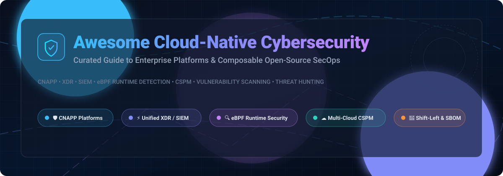

<p align="center">
  
</p>

# 🛡️ Awesome Cloud-Native Cybersecurity Platform

<p align="center">
  <a href="https://github.com/ishandutta2007/Awesome-Awesome-Awesome"></a><a href="https://discord.gg/jc4xtF58Ve"></a>
  <a href="https://github.com/ishandutta2007/Awesome-Cloud-Native-Cybersecurity-Platform/stargazers"></a>
  <a href="https://github.com/ishandutta2007/Awesome-Cloud-Native-Cybersecurity-Platform/network/members"></a>
  <a href="https://github.com/ishandutta2007/Awesome-Cloud-Native-Cybersecurity-Platform/issues"></a>
  <a href="https://github.com/ishandutta2007/Awesome-Cloud-Native-Cybersecurity-Platform/blob/main/LICENSE"></a>
  <a href="https://github.com/ishandutta2007"></a>
</p>

> 🌟 **A curated list of leading Cloud-Native Cybersecurity Platforms, Enterprise SaaS, and Composable Open-Source Security Solutions.**
>
> 🎯 *Mastering CNAPP (Cloud-Native Application Protection Platform), XDR (Extended Detection & Response), Next-Gen SIEM, eBPF Runtime Security, CSPM (Cloud Security Posture Management), Vulnerability Scanning, and Self-Hosted SecOps.*

---

## 📑 Table of Contents

- [🌐 Sector Overview & Market Dynamics](#-sector-overview--market-dynamics)
- [🏢 Enterprise SaaS & Hosted Platforms](#-enterprise-saas--hosted-platforms)
- [🔓 Curated Open-Source GitHub Projects](#-curated-open-source-github-projects)
  - [🛡️ Composable Security Architecture Guide](#-composable-security-architecture-guide)
- [🤝 How to Contribute](#-how-to-contribute)
- [💖 Support & Sponsorship](#-support--sponsorship)
- [⚠️ Disclaimer](#-disclaimer)
- [📈 Star History](#-star-history)

---

## 🌐 Sector Overview & Market Dynamics

The global cloud-native cybersecurity and cloud security market is valued at approximately **$41B–$46B (2025)** and projected to exceed **$60B by 2026**, registering a robust **15%–18% CAGR**. 

Market structure exhibits a dual dynamic:
- **Moderately Fragmented in Emerging Specializations**: Rapid technological shifts across containers, Kubernetes clusters, serverless architectures, and AI workloads sustain widespread innovation across specialized niches (such as runtime eBPF telemetry, cloud security posture management, and attack path analysis).
- **Heavily Concentrated at the Enterprise Platform Level**: Large enterprises increasingly combat tool sprawl and "point-solution fatigue" by consolidating budgets around unified multi-product platforms and mega-cap vendors that bundle endpoint, cloud identity, and extended threat response.

---

## 🏢 Enterprise SaaS & Hosted Platforms

Enterprise-grade commercial cybersecurity suites offering unified detection graphs, managed threat intelligence, and turnkey cloud security posture management.

| Platform | Company Valuation / Revenue (Desc) | Pricing (Starting Tier) | Free Tier Limits / Free Trial | Key Capabilities & Target Fit |
| :--- | :--- | :--- | :--- | :--- |
| **[Microsoft Defender XDR](https://www.microsoft.com/en-us/security/business/microsoft-defender)** | **~$3.85T** Market Cap ($281.7B Revenue) | **$3.00/user/month** (Defender for Endpoint P1 / Defender for Business) | **30-day free trial** with full feature access for enterprise tenants (No permanent free tier) | Unified XDR across endpoints, hybrid cloud, M365 identities; best for Microsoft-centric enterprise ecosystems. |
| **[Cisco Security Cloud](https://www.cisco.com/)** | **~$430B** Market Cap ($56.7B Revenue) | **$3.00/user/month** (Cisco Duo MFA starting tier; Secure Endpoint starts ~$30/user/year via channel) | **Permanent free tier** for Duo up to 10 users; **30-day free trial** for Secure Endpoint & **90-day free trial** for Multicloud Defense | Unified network, cloud, and endpoint security; best for Cisco-centric infrastructures seeking fabric integration. |
| **[Palo Alto Cortex](https://www.paloaltonetworks.com/cortex)** | **~$125B** Market Cap ($9.2B Revenue) | **$70.00/endpoint/year** (Cortex XDR Pro base tier with 30-day retention; Cloud Host Protection starts at $195/host/year) | **Guided 30-day PoC / trial** via sales or authorized partners; no instant self-service free tier | AI-driven SecOps with XDR, XSIAM, and Xpanse ASM; best for enterprise SecOps looking for automated incident resolution. |
| **[CrowdStrike Falcon Platform](https://www.crowdstrike.com/)** | **~$110B** Market Cap ($3.95B Revenue) | **$59.99/device/year** ($7.99/device/month on Falcon Go, up to 100 devices; Falcon Pro at $99.99/device/year) | **15-day free trial** with full platform capabilities and no credit card required (No permanent free tier) | Cloud-native endpoint, CNAPP, and identity protection with Threat Graph telemetry; industry benchmark for enterprise EDR/XDR. |
| **[Fortinet FortiCloud](https://www.fortinet.com/)** | **~$105B** Market Cap ($6.8B Revenue) | **~$90–$267/device/year** (FortiGate Cloud management license for entry models like 40F/60F; bundles available) | **Permanent free tier** (7-day rolling log retention, basic reporting, firmware updates); **30-day free trial** unlocks full 1-year log retention and config backups | Centralized cloud management for Fortinet Security Fabric; best for distributed networks utilizing FortiGate appliances. |
| **[Wiz](https://www.wiz.io/)** | **$32B** Valuation (Acquisition by Google; $1B ARR target) | **$24,000/year** (Wiz Essential starting tier for up to 100 cloud workloads; Wiz Advanced at ~$38,000/year) | **Guided PoC / sandbox evaluation** for qualified cloud tenants (No public self-service trial or permanent free tier) | Agentless security graph correlating multi-cloud posture, vulnerabilities, CIEM, and workload risks. |
| **[Check Point Infinity](https://www.checkpoint.com/)** | **~$20B** Market Cap ($2.73B Revenue) | **~$30–$40/user/year** (Harmony Browse; Harmony Endpoint starts at ~$40–$50/seat/year) | **30-day free trial** for Infinity Portal cloud-managed services (Harmony Endpoint and Harmony Browse) | Consolidated security architecture covering network, cloud, SASE, and endpoint from a single policy engine. |
| **[SentinelOne Singularity](https://www.sentinelone.com/)** | **~$8.5B** Market Cap ($821.5M Revenue) | **$69.99/endpoint/year** (~$5.83/endpoint/month on Singularity Core; Singularity Control at $79.99/endpoint/year) | **30-day proof-of-concept (PoC) / trial** available through partner/sales onboarding (No permanent free tier) | AI-native autonomous endpoint and cloud protection with behavioral rollback and Purple AI hunting. |
| **[Trend Micro Vision One](https://www.trendmicro.com/)** | **~$5.5B** Market Cap ($1.8B Revenue) | **~$26–$36/device/year** (Vision One Endpoint Security Core; AWS Marketplace pay-as-you-go hourly options) | **30-day free trial** available directly and via AWS Marketplace (No permanent free tier) | Broad multi-layer XDR spanning email, endpoint, server, and multi-cloud environments. |
| **[Sophos Central](https://www.sophos.com/)** | **~$3.9B** Enterprise Valuation ($1B+ Revenue) | **~$28–$70/user/year** (Sophos Intercept X Advanced base endpoint tier; XDR tier from ~$45–$108/user/year) | **30-day fully functional free trial** with no credit card or contract required (No permanent free tier) | Unified management for endpoint, firewall, and MDR operations; tailored for mid-market and distributed enterprises. |

---

## 🔓 Curated Open-Source GitHub Projects

Curated list of production-grade open-source tools for building self-hosted, sovereign, and composable cloud-native security stacks. Sorted by GitHub community star count in descending order.

### 1. **[Trivy](https://github.com/aquasecurity/trivy)** [](https://github.com/aquasecurity/trivy/stargazers)
* **Description**: Comprehensive, versatile vulnerability, misconfiguration, secret, and SBOM scanner for containers, Kubernetes, code repositories, and multi-cloud clouds.
* **License**: Apache-2.0
* **Key Features**: Container image scanning, IaC misconfigurations (Terraform, CloudFormation, Dockerfile), software bill of materials (SBOM) generation (CycloneDX, SPDX), Git secrets detection, and fast CI/CD integration with GitHub Actions.
* **Best For**: Shift-left vulnerability management and CI/CD supply chain hardening.

### 2. **[Cilium](https://github.com/cilium/cilium)** [](https://github.com/cilium/cilium/stargazers)
* **Description**: eBPF-powered cloud-native networking, transparent encryption, and deep security observability for Kubernetes and microservices.
* **License**: Apache-2.0 (CNCF Graduated)
* **Key Features**: Identity-aware Layer 3–Layer 7 network security policies, wireguard/IPsec node-to-node transparent encryption, Hubble network flow visualization, and real-time DNS/API payload inspection without sidecars.
* **Best For**: Microservice network segmentation, zero-trust cloud network policy enforcement, and live cluster traffic inspection.

### 3. **[Wazuh](https://github.com/wazuh/wazuh)** [](https://github.com/wazuh/wazuh/stargazers)
* **Description**: The leading unified open-source XDR and SIEM platform for endpoint protection, server telemetry, and multi-cloud workload threat detection.
* **License**: GPLv2
* **Key Features**: Host-based intrusion detection (FIM, rootkit discovery, log analysis), vulnerability detection, CIS benchmark configuration compliance (PCI-DSS, HIPAA, GDPR, NIST), active response automation, and cloud workload monitoring across AWS, Azure, and GCP.
* **Best For**: Building a robust, self-hosted XDR/SIEM nerve center with host, server, and multi-cloud telemetry.

### 4. **[CrowdSec](https://github.com/crowdsecurity/crowdsec)** [](https://github.com/crowdsecurity/crowdsec/stargazers)
* **Description**: Collaborative open-source intrusion prevention system (IPS), WAF, and bot mitigation engine with a crowdsourced threat intelligence blocklist.
* **License**: MIT
* **Key Features**: Lightweight log-parsing agent analyzing behavior across Linux, Windows, Docker, Traefik, and NGINX; automatic threat remediation through bouncers (firewall, Captcha, CDN); peer-shared global reputation blocklist.
* **Best For**: Edge protection, web application defense, and blocking brute-force, credential stuffing, and scanner bots.

### 5. **[Prowler](https://github.com/prowler-cloud/prowler)** [](https://github.com/prowler-cloud/prowler/stargazers)
* **Description**: The industry-standard open-source multi-cloud security posture management (CSPM) and compliance auditing framework.
* **License**: Apache-2.0
* **Key Features**: Over 300+ automated configuration audits across AWS, Microsoft Azure, Google Cloud Platform (GCP), and Kubernetes; mapping directly to CIS, NIST, PCI-DSS, SOC 2, and ISO 27001; SARIF generation and CI/CD posture gating.
* **Best For**: Continuous cloud security posture assessment, regulatory compliance auditing, and multi-cloud misconfiguration detection.

### 6. **[Falco](https://github.com/falcosecurity/falco)** [](https://github.com/falcosecurity/falco/stargazers)
* **Description**: De facto standard cloud-native runtime threat detection engine for containers, hosts, and Kubernetes powered by eBPF.
* **License**: Apache-2.0 (CNCF Graduated)
* **Key Features**: Kernel-level syscall interception via eBPF; rich YAML rule language detecting container escapes, privilege escalation, shell spawns in containers, and sensitive directory access; 50+ plugins (AWS CloudTrail, Okta, GitHub).
* **Best For**: Real-time Kubernetes container runtime security monitoring and behavioral anomaly alerting.

### 7. **[Kyverno](https://github.com/kyverno/kyverno)** [](https://github.com/kyverno/kyverno/stargazers)
* **Description**: Kubernetes-native policy-as-code management engine designed specifically for declarative admission control and validation.
* **License**: Apache-2.0 (CNCF Incubating)
* **Key Features**: Validate, mutate, generate, and verify Kubernetes resources using idiomatic Kubernetes YAML (no complex rego scripting required); cryptographic container image signature validation with Sigstore Cosign.
* **Best For**: Enforcing security baseline policies, rootless container execution, and supply chain verification at the Kubernetes API admission barrier.

### 8. **[Cloud Custodian](https://github.com/cloud-custodian/cloud-custodian)** [](https://github.com/cloud-custodian/cloud-custodian/stargazers)
* **Description**: Lightweight YAML DSL rules engine for unifying multi-cloud real-time compliance, security remediation, and cost optimization.
* **License**: Apache-2.0 (CNCF Incubating)
* **Key Features**: Real-time event-driven policies using AWS CloudWatch, Azure Event Grid, and GCP Cloud Pub/Sub; automated enforcement actions (quarantine unencrypted buckets, kill unauthorized compute instances, tag uncompliant resources).
* **Best For**: Automated real-time multi-cloud guardrail enforcement and automated incident mitigation.

### 9. **[Deepfence ThreatMapper](https://github.com/deepfence/ThreatMapper)** [](https://github.com/deepfence/ThreatMapper/stargazers)
* **Description**: Open-source Cloud-Native Application Protection Platform (CNAPP) providing context-aware attack path analysis and vulnerability prioritization.
* **License**: Apache-2.0
* **Key Features**: Topology mapping across hosts, Kubernetes clusters, and serverless tasks; correlates runtime attack paths from public internet entry points to crown-jewel internal data assets; automated vulnerability and secret discovery.
* **Best For**: Visualizing cloud security risk topology and deploying an open-source approximation of commercial CNAPP platforms.

### 10. **[Tetragon](https://github.com/cilium/tetragon)** [](https://github.com/cilium/tetragon/stargazers)
* **Description**: Deep eBPF-based security observability and kernel-level runtime enforcement engine with synchronous in-kernel blocking.
* **License**: Apache-2.0
* **Key Features**: Tracks process execution, namespace manipulation, and network sockets; provides real-time synchronous prevention inside the Linux kernel (SIGKILL) without user-space latency.
* **Best For**: High-security runtime containment, detecting unauthorized file access, and kernel-level enforcement against container break-outs.

### 11. **[Matano](https://github.com/matanolabs/matano)** [](https://github.com/matanolabs/matano/stargazers)
* **Description**: Open-source petabyte-scale security data lake and serverless SIEM alternative running directly within your AWS environment.
* **License**: Apache-2.0
* **Key Features**: Apache Iceberg columnar storage in Amazon S3; zero-ops serverless data ingestion (Lambda, SQS); detection-as-code written in Python; vendor-neutral SQL analytics accessible via Snowflake, Trino, and Athena.
* **Best For**: Security engineering teams frustrated by costly enterprise SIEM licenses seeking modern data lake retention and Python detection rules.

### 12. **[UTMStack](https://github.com/utmstack/UTMStack)** [](https://github.com/utmstack/UTMStack/stargazers)
* **Description**: All-in-one open-source Next-Gen SIEM and SOAR platform delivering real-time correlation and compliance reporting.
* **License**: AGPL-3.0
* **Key Features**: Automated correlation rules, incident lifecycle tracking, integrated vulnerability scanning, and pre-built compliance dashboards for ISO 27001, SOC 2, and GDPR.
* **Best For**: Small-to-medium security teams wanting an integrated turnkey SIEM/SOAR web interface.

---

### 🛡️ Composable Security Architecture Guide

How to assemble these open-source tools into an enterprise-grade sovereign security stack:

```
+-----------------------------------------------------------------------------------+
|                           Shift-Left & CI/CD Security                             |
|         Trivy (Vulnerabilities, Secrets, SBOM)  +  Kyverno (Policy Gate)          |
+-----------------------------------------------------------------------------------+
                                         │
                                         ▼
+-----------------------------------------------------------------------------------+
|                        Multi-Cloud Posture & Governance                           |
|       Prowler (Multi-cloud CSPM Audits)  +  Cloud Custodian (Automated Actions)   |
+-----------------------------------------------------------------------------------+
                                         │
                                         ▼
+-----------------------------------------------------------------------------------+
|                        Kubernetes & Workload Runtime                              |
|       Falco (Syscall Runtime Detections)  +  Tetragon (eBPF Synchronous Block)     |
|                   Cilium (eBPF Network Zero-Trust & L7 Firewall)                  |
+-----------------------------------------------------------------------------------+
                                         │
                                         ▼
+-----------------------------------------------------------------------------------+
|                      CNAPP Topology & Attack Path Mapping                         |
|                    Deepfence ThreatMapper (Attack Graph Prioritization)           |
+-----------------------------------------------------------------------------------+
                                         │
                                         ▼
+-----------------------------------------------------------------------------------+
|                        Unified SIEM, XDR & Data Lake                              |
|   Wazuh (Host Telemetry & Active Response)  +  Matano (AWS S3 Iceberg Data Lake)  |
|                         CrowdSec (Edge Defense & Global IP CTI)                   |
+-----------------------------------------------------------------------------------+
```

---

## 🤝 How to Contribute

Contributions are warmly welcomed! Help keep this curated landscape updated, accurate, and community-driven.

1. **Fork** the repository on GitHub.
2. **Create a branch** for your feature or update:
   ```bash
   git checkout -b feature/add-new-security-platform
   ```
3. **Add or update** entries in `README.md` following the established table or badge structure.
4. **Ensure high quality**: Include verified pricing starting tiers, trial boundaries, and star badge metrics.
5. **Submit a Pull Request** with a descriptive summary of your changes.

---

## 💖 Support & Sponsorship

Thank you for exploring and bookmarking this project! If this curated guide helps your engineering, DevOps, or SecOps workflows, please consider supporting the project:

- ⭐ **Star this repository** to help others discover it across GitHub.
- 🍴 **Fork and share** the repo with your security teammates and community.
- ☕ **Sponsor the Maintainer**: Buy a coffee or support ongoing open-source research via the [GitHub Sponsor Dashboard](https://github.com/sponsors/ishandutta2007).

Your support enables continuous updates, community contributions, and deep technical evaluation of the cloud security ecosystem!

---

## ⚠️ Disclaimer

- This curated collection is compiled for informational and educational purposes. Inclusion does not constitute a formal commercial endorsement.
- All trademarks, service marks, logos, and company names cited are the property of their respective owners.
- Cloud-native security platforms handle sensitive environment credentials, configuration logs, and telemetry. Ensure proper data protection (GDPR, CCPA, SOC 2) and rigorous least-privilege access controls are established prior to connecting production environments.

---

## 📈 Star History

[](https://star-history.dera.page/#ishandutta2007/Awesome-Cloud-Native-Cybersecurity-Platform&type=date&legend=top-left)
